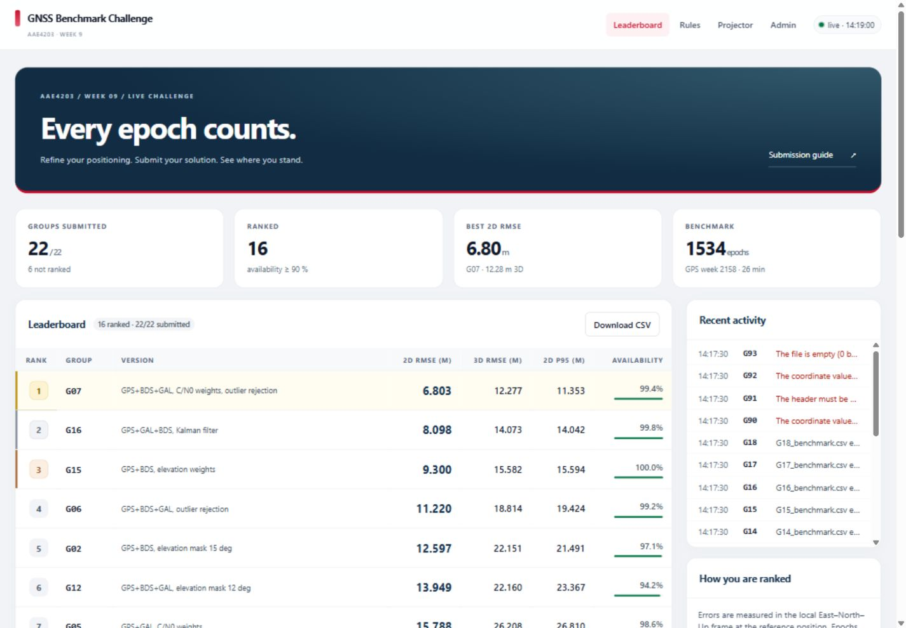
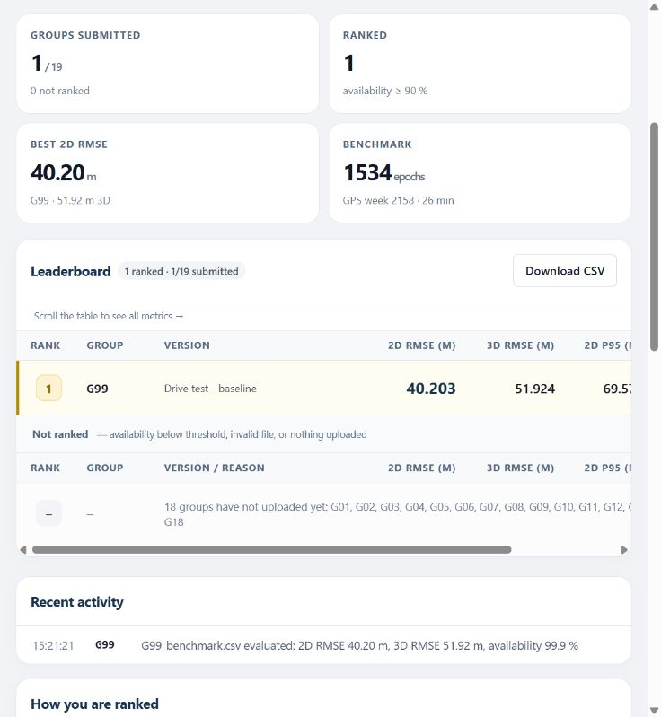
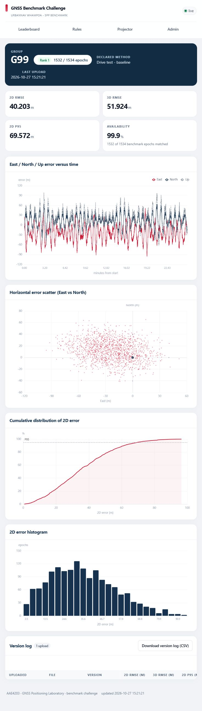

# GNSS Benchmark Challenge

A classroom competition platform for GNSS positioning assignments. Students submit ECEF position estimates through Google Drive; the server validates each CSV, evaluates it against a reference trajectory, and updates a live leaderboard.

Built for the **AAE4203 Week 9 GNSS Positioning Laboratory**. The application uses Python's standard library, SQLite, plain HTML/CSS/JavaScript, and a bundled ECharts frontend. No frontend build step is required.

## Simple usage guide

### 1. Start the server (teacher)

Complete the [first-time setup](#quick-start) once: install Python 3.11+, create `config.toml`, prepare the reference data, and set the Google Drive sync folder. Keep Google Drive for Desktop running and signed in.

Open a terminal in the project folder and run:

```powershell
python run.py --check
python run.py --host 127.0.0.1 --port 8080
```

Keep this terminal open. Visit **[the leaderboard](http://127.0.0.1:8080/)** in your browser. Students on another computer must use the teacher's LAN URL, not `127.0.0.1`; see [classroom network access](#classroom-network-access).

To continue the separate Drive test environment used during development, run this **instead of** `run.py`:

```powershell
python tools/live_drive_test.py --host 127.0.0.1 --port 8080
```

This uses a separate test database. Run only one server on port 8080 at a time. On Windows, replace `python` with `py -3` if that is your installed Python launcher.

### 2. Upload your answer (student)

**Upload here: [Google Drive — TA folder](https://drive.google.com/drive/folders/1IxPmQCfAS_fVZEcn9TMloStXUjBWLSov?usp=drive_link)**

Sign in with the Google account granted access by your teaching assistant. If Drive shows an access request, contact the teaching team. Open your assigned group folder inside the TA folder before uploading.

1. Open the TA folder using the Google Drive link above.
2. Open your assigned group folder, such as `G01`.
3. Upload both `G01_benchmark.csv` and `G01_owndata.csv`. Optionally upload `G01_version.txt` with a short description of your method. Replace `G01` with your group number.
4. When improving your solution, replace the same file. Do not create backup copies with suffixes such as `(1)` or `_old`.
5. Leave the leaderboard open. It updates automatically after Drive Desktop syncs the file and the server scans it (every 10 seconds by default).

Validate your CSV before uploading:

```powershell
python tools/check_submission.py G01_benchmark.csv
```

A valid submission needs **at least 90% availability** to receive a rank. Click your group on the leaderboard to view metrics, plots, and submission history. `GXX_owndata.csv` is checked for format only and does not receive a rank.

### 3. Stop or restart the server (teacher)

In the terminal running the server, press:

```text
Ctrl+C
```

Wait for the command prompt to return. Closing the browser tab does **not** stop the server. To restart, run the same start command again. The main server keeps its results in `data/`; the Drive test server keeps its results separately in `.review/drive-live/data/`.

### Screenshots

**Leaderboard — synthetic classroom rehearsal data**



**Real Drive sync test — the synthetic G99 submission was picked up and ranked automatically**



<details>
<summary>View the group results page: error plots and submission history</summary>



</details>

---

## Features

- Automatic submission discovery through Google Drive for Desktop or the Google Drive API.
- CSV validation with feedback for incorrect headers, units, coordinates, and timestamps.
- Ranking by 2D RMSE, with 3D RMSE as the tie-breaker and a minimum availability threshold.
- Live leaderboard updates using Server-Sent Events (SSE).
- Group pages with error plots, metrics, and submission history.
- Projector view for classroom displays.
- Teacher console for manual uploads, rescanning, rescoring, withdrawal, and freezing.
- Archived submissions and a local SQLite database for reviewing results.

This is a **CSV evaluation platform**. It does not execute student code, authenticate individual students, or collect report PDFs. Manage student folder permissions in Google Drive and collect reports/code through your course's existing systems.

## How it works

```text
Student algorithm
      |
      v
GXX_benchmark.csv -> Google Drive group folder
                              |
                 Desktop sync or Drive API
                              |
                              v
                   Scan -> Validate -> Score
                              |
                       SQLite + archive
                              |
                              v
                     Live leaderboard (SSE)
```

The default scan interval is **10 seconds**. Drive synchronization adds its own delay; an upload is evaluated only after it becomes visible to the configured source. Local files also have a configurable settling delay.

## Requirements

- Python **3.11+**, available as `python` (or use `py -3` on Windows).
- A reference trajectory and the corresponding benchmark observation data, supplied separately by the instructor.
- A modern browser.
- For Desktop sync: Google Drive for Desktop, signed in with access to the submission folder.
- For the API source only: packages in `requirements-drive.txt` and a configured service account.

**Datasets, answer keys, credentials, student submissions, and local databases are not included in this repository.** A fresh clone can run the unit tests immediately, but needs a reference dataset and configuration to serve a challenge.

## Quick start

Run commands from the repository root. The examples below use PowerShell.

### 1. Create your local configuration

```powershell
Copy-Item config.example.toml config.toml
```

Edit `config.toml`. For an initial local test:

```toml
[server]
host = "127.0.0.1"
port = 8080
admin_token = "REPLACE_WITH_A_LONG_RANDOM_TOKEN"
```

Edit the existing sections rather than adding duplicate TOML sections. Replace the example token before using the teacher console. You can also supply it through the `AAE4203_ADMIN_TOKEN` environment variable.

### 2. Build the reference store

Obtain the authorized reference and observation files from the instructor. For the existing Whampoa dataset format:

```powershell
python tools/build_ground_truth.py UrbanNav_whampoa_raw.txt --format ie --name whampoa --obs UrbanNav-HK-Deep-Urban-1.ublox.f9p.obs
```

This creates `data/ground_truth/whampoa.private.csv` and its metadata. Ensure `challenge.gt_file` in `config.toml` points to that output. The `--obs` option restricts reference epochs to those present in the observation file.

For another dataset, use the builder's `--help` and update the challenge configuration accordingly.

### 3. Configure submissions

For a local rehearsal, create an empty input directory:

```powershell
New-Item -ItemType Directory -Force drive_mirror
```

```toml
[sources]
kind = "local_mirror"

[sources.local_mirror]
root = "drive_mirror"
include_owndata = true
```

For live Drive submissions, replace `root` with the actual synced folder, for example:

```toml
root = "G:/My Drive/AAE4203/TA folder"
```

Use the actual path shown in File Explorer; localized folder names are supported. Use forward slashes in TOML paths. Merely creating a folder named `drive_mirror` does not connect it to Google Drive.

### 4. Check and run

```powershell
python run.py --check
python run.py
```

Open [http://127.0.0.1:8080/](http://127.0.0.1:8080/). Stop the server with **Ctrl+C**. `start.bat` is also available on Windows once Python is installed and configured.

| Page | Route |
| --- | --- |
| Leaderboard | `/` |
| Projector | `/tv` |
| Submission rules | `/rules` |
| Group results | `/group/G01` |
| Teacher console | `/admin` |

## Student submission workflow

Official groups are **G01–G20**. Submit both required CSV files in the matching group folder:

```text
TA folder/
  G01/
    G01_benchmark.csv
    G01_owndata.csv
    G01_version.txt
  G02/
    G02_benchmark.csv
    G02_version.txt
```

- `GXX_benchmark.csv`: evaluated and eligible for ranking.
- `GXX_owndata.csv`: required; format-checked, but not ranked.
- `GXX_version.txt`: optional method description; its first nonempty line appears in the Version column.

The filename must match its parent group folder; files in the TA folder root or a different group folder are skipped. Use exact submission filenames. Backup names such as `G01_benchmark_old.csv` are ignored. Duplicate recognized files for the same group and submission type are reported and skipped rather than selected arbitrarily.

Replace the existing file when submitting a new solution. The latest accepted submission record determines the displayed result, even if the new file is invalid or worse than the previous attempt. Re-uploading identical content does not create a new history entry; changing the version description updates the label.

### CSV format

```csv
gps_week,gps_tow_s,x_ecef_m,y_ecef_m,z_ecef_m
2158,455346.0,-2418202.586,5385847.524,2405648.799
2158,455347.0,-2418202.174,5385847.238,2405648.952
```

The rows above illustrate the format, not a complete benchmark solution. Use WGS-84 ECEF coordinates in metres, a GPS week integer, and GPS time-of-week in seconds. Write time with at least one decimal place and coordinates with exactly three decimals. Scientific notation, duplicate timestamps, unsorted rows and extra columns (including blank trailing fields) are rejected by both the server and checker.

Validate before uploading:

```powershell
python tools/check_submission.py G01_benchmark.csv
```

For a different benchmark, pass the appropriate `--week` and `--epochs` values to the checker.

## Scoring and ranking

| Rule | Default behavior |
| --- | --- |
| Epoch matching | GPS week and time-of-week, on a 0.1-second grid (additional tolerance disabled by default) |
| Availability | Matched epochs / reference epochs × 100% |
| Ranking eligibility | Valid benchmark submission with availability ≥ 90% |
| Primary metric | Lowest 2D RMSE |
| Tie-breaker | Lowest 3D RMSE; group code provides deterministic ordering if both tie |
| Additional metric | 95th-percentile 2D error |
| Missing or invalid submission | No rank |

See [scoring details](docs/scoring.md) for formulas and the current dataset assumptions.

The reference file is not directly served over HTTP. **Group endpoints expose signed per-epoch error feedback and the ENU origin, which can allow participants to infer reference positions from their own submissions.** This is an intentional teaching choice in the current project, not a strict hidden-answer competition design.

## Google Drive API option

Use this when the server cannot run Drive for Desktop:

```powershell
python -m pip install -r requirements-drive.txt
```

```toml
[sources]
kind = "gdrive_api"

[sources.gdrive_api]
root_folder_id = "YOUR_SUBMISSION_FOLDER_ID"
credentials_file = "secrets/gdrive-service-account.json"
include_owndata = true
```

Enable the Google Drive API for your Google Cloud project, provide a service-account JSON key locally, and grant that account read access to the submission folder. Run `python run.py --check` to verify access. Never commit the key.

## Classroom network access

Start locally first. To share the leaderboard, bind to the server's intended LAN address using `--host`, then give students `http://SERVER_IP:8080/`.

```powershell
python run.py --host YOUR_LAN_IPV4 --port 8080
```

Allow inbound TCP 8080 only for the intended network scope. Campus Wi-Fi may isolate clients or place them on different subnets. Test from a second device. This server uses HTTP and token-based teacher controls; use an appropriate HTTPS reverse proxy and access controls before exposing it beyond a trusted classroom network.

## Tests and rehearsal

Run unit and regression tests without a live Drive connection or private dataset:

```powershell
python -m unittest discover -s tests -v
```

The suite covers coordinate conversion, CSV validation, epoch matching, ranking eligibility, metadata updates, withdrawal, rescoring, and source handling. Drive API behavior is mocked in these tests; passing them does not prove cloud synchronization or campus connectivity.

To generate synthetic submissions after configuring the reference dataset:

```powershell
python tools/make_demo_dataset.py --out demo_drive --faults
```

Point a rehearsal configuration's mirror root at `demo_drive`, or use the tools below. Avoid mixing generated submissions into the live student folder.

| Tool | Purpose |
| --- | --- |
| `tools/build_ground_truth.py` | Build the local reference store |
| `tools/check_submission.py` | Validate a student's CSV |
| `tools/score_cli.py` | Evaluate submissions offline |
| `tools/make_demo_dataset.py` | Generate synthetic rehearsal submissions |
| `tools/rehearse.py` | Copy rehearsal submissions into a local test mirror |
| `tools/review_smoke.py` | Project-specific isolated integration checks; requires generated demo files and the local dataset/database setup |
| `tools/live_drive_test.py` | Scan the configured source using a separate test database under `.review/drive-live/` |

To test real Drive sync with an isolated database:

```powershell
python tools/live_drive_test.py
```

Upload a test CSV through the **Drive website**, wait for Desktop sync, and confirm the browser updates automatically. Replace the same file with a different solution and verify both the new metrics and the history. Copying a file directly into the local mirror alone does not verify the cloud-to-desktop path.

## Repository layout

```text
app/                 Scoring, persistence, HTTP server, polling and source adapters
web/                 Leaderboard, projector, group, rules and teacher pages
web/assets/          Shared styles, browser helpers and bundled ECharts
config.example.toml  Shareable configuration template
run.py               Main server entry point
start.bat / start.sh Convenience launchers
tools/               Validation, dataset preparation and test utilities
tests/               Unit and regression tests
docs/                Scoring documentation and teaching assistant runbook
```

For classroom operation, see [the Chinese manual](MANUAL.md) and [the TA runbook](docs/TA_runbook.md).

## Initialize this project on GitHub

The following commands are instructions for the repository owner; publishing is a separate step from preparing this README.

1. Create an empty GitHub repository. Leave its README, license and `.gitignore` initialization options unchecked because this project already contains local documentation and ignore rules.
2. From the project root, run:

```powershell
git init
git branch -M main
git add .
git status --short
git diff --cached --stat
```

3. Review the staged files. Only stage material you intend to publish. The provided `.gitignore` excludes local configuration, credentials, grading data, test outputs, raw course datasets and the supplied slide deck. Ignore rules do not remove files already tracked by Git.
4. Commit and connect your repository, replacing `YOUR_USERNAME` and `YOUR_REPOSITORY`:

```powershell
git commit -m "Initial commit: GNSS benchmark challenge platform"
git remote add origin https://github.com/YOUR_USERNAME/YOUR_REPOSITORY.git
git push -u origin main
```

No project license has been selected. Add a suitable `LICENSE` before presenting the project as open-source software, and retain applicable third-party notices for bundled dependencies. Dataset and course-material redistribution permissions must be considered separately.
